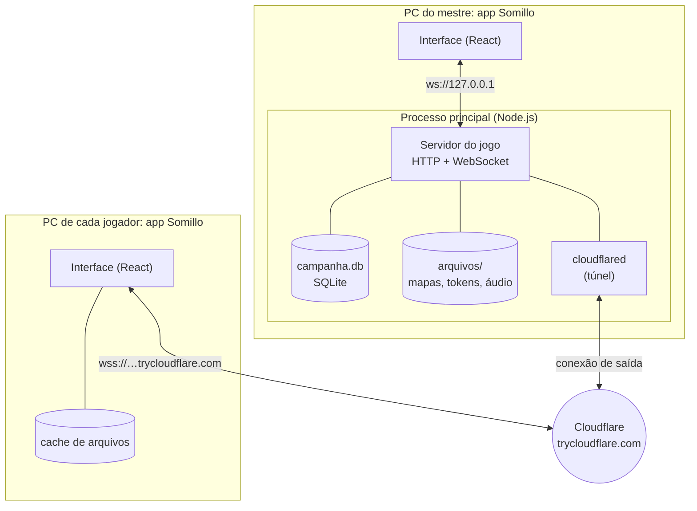
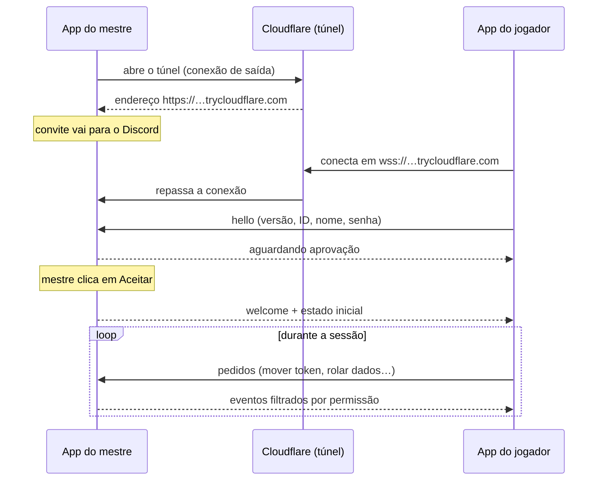
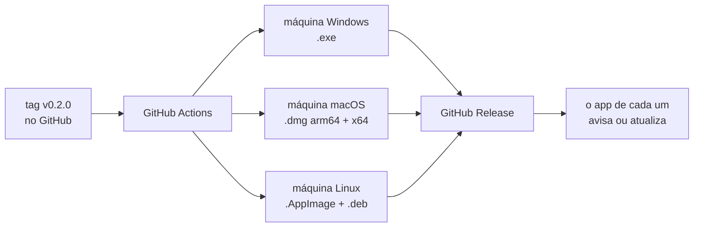
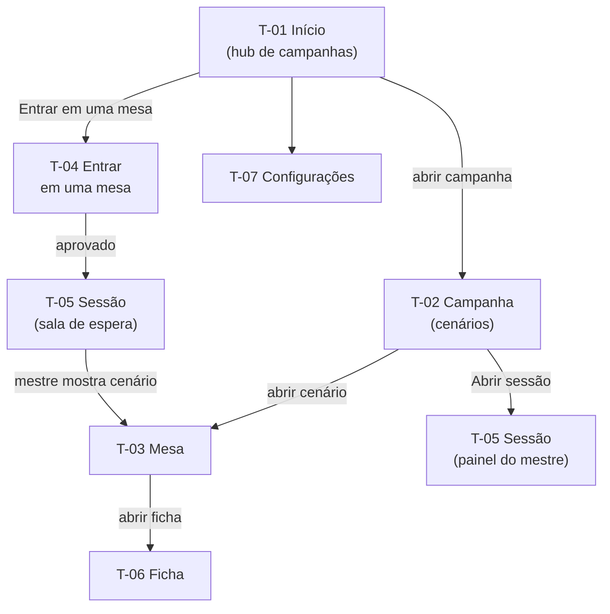

# Somillo — Mesa de RPG

**Especificação do produto · versão 0.1 (rascunho) · 08/11/2026**

> Nome internacional: *Somillo — RPG Table*. Campanha de estreia: **Maldição Cavérica** (D&D 5e).

## 0. Como usar este documento

Este é o **documento mestre** do Somillo. Ele responde a três perguntas: **o que** o app faz, **como** ele é construído e **em que ordem** as partes serão implementadas. Nenhuma linha de código será escrita antes de a etapa correspondente estar especificada aqui e aprovada.

Onde fica cada coisa:

| Arquivo | Conteúdo | Quem escreve |
|---|---|---|
| `especificacao/ESPECIFICACAO.md` (este) | visão, decisões técnicas, rede, distribuição, roteiro de etapas | Claude, com a sua revisão |
| `especificacao/telas/T-xx-*.md` | o que cada tela mostra e faz | você (Claude ajuda e revisa) |
| `especificacao/funcionalidades/F-xx-*.md` | regras que atravessam várias telas (dados, névoa…) | você (Claude ajuda e revisa) |
| `especificacao/COMO-ESCREVER.md` | guia para escrever telas e funcionalidades | Claude |
| `especificacao/modelos/` | modelos em branco para copiar | Claude |
| `especificacao/Especificacao-Somillo.pdf` | tudo acima reunido para leitura | gerado por script |

**Regra de precedência.** O roteiro (seção 9) traz uma *proposta* de requisitos para cada etapa. Quando existir um arquivo de tela ou funcionalidade com status `pronto`, **ele vence** o roteiro em caso de conflito, e este documento é atualizado para refletir isso.

**Convenções**

- **deve** = obrigatório · **pode** = opcional · **não deve** = proibido.
- **(proposta)** = sugestão do Claude aguardando a sua aprovação.
- IDs: `RF-3.2` (requisito 2 da Etapa 3), `T-01` (tela), `F-01` (funcionalidade), `D-01` (decisão tomada), `Q-01` (pergunta em aberto).
- `[Etapa N]` ao lado de um item = esse item só entra na Etapa N.

## 1. Visão geral

### 1.1 O que é o Somillo

O Somillo é uma mesa de RPG virtual **caseira**, feita para um grupo de amigos. É um único app, instalado em todos os computadores (Windows, macOS e Linux), em que:

- o **mestre** guarda tudo da campanha no próprio computador (mapas, tokens, fichas, histórico) e **hospeda a sessão** quando é dia de jogo;
- os **jogadores** clicam em **Entrar em uma mesa**, colam o convite e caem na mesa do mestre.

Não existe servidor na nuvem, conta ou mensalidade. Quando o mestre encerra a sessão, a mesa "fecha".

### 1.2 De onde vêm as ideias

O Somillo junta o que há de melhor em quatro ferramentas:

| Referência | O que o Somillo pega dela | Etapas |
|---|---|---|
| **Owlbear Rodeo** | Simplicidade: abrir um mapa e jogar em segundos; tokens arrastáveis; névoa de guerra fácil. | 3, 4, 6 |
| **Roll20** | A mesa completa: camada do mestre, iniciativa, régua e áreas de efeito, handouts, jukebox de áudio. | 4, 8, 9, 10, 11 |
| **D&D Beyond** | Fichas de D&D 5e com cálculos automáticos e rolagem com um clique. | 7 |
| **Dice Maiden** (bot do Discord) | Rolagem por comando de texto, com sintaxe poderosa: manter os maiores, explodir, contar sucessos, repetir. | 5 |

### 1.3 Princípios

1. **O mestre é o servidor e o dono dos dados.** Nada vai para a nuvem; fazer backup é copiar uma pasta.
2. **Um app só.** Qualquer pessoa pode ser mestre da própria campanha e jogador na campanha de outra.
3. **Simples antes de completo.** Primeiro o essencial, no estilo Owlbear; a complexidade do Roll20 vem depois.
4. **Uma etapa de cada vez.** Cada etapa vira uma versão instalável, testada pelo grupo, antes de a próxima começar.
5. **Quem manda é o servidor.** Segredos do mestre (tokens ocultos, névoa, notas, rolagens secretas) nunca saem do computador dele, e os dados são rolados no servidor.
6. **Feito para D&D 5e, sem amarrar o resto.** Mapa, dados e chat servem para qualquer sistema; só as fichas são específicas do 5e.

### 1.4 Um dia de jogo com o Somillo

1. Sexta à noite, o mestre abre o Somillo, entra na campanha **Maldição Cavérica** e clica em **Abrir sessão**.
2. Em segundos o app mostra um **convite**. O mestre cola o convite no canal do Discord (ou o próprio app o posta lá).
3. Cada jogador abre o Somillo, clica em **Entrar em uma mesa**, cola o convite e cai na sala de espera.
4. O mestre escolhe o cenário **Floresta Mágica** e clica em **Mostrar aos jogadores**. O mapa aparece para todos, com os tokens dos personagens.
5. Os jogadores movem os próprios tokens; a névoa esconde o que ninguém explorou ainda.
6. Um goblin surge (o mestre revela o token escondido). Iniciativa! O rastreador ordena todo mundo.
7. A barda clica em "Rapieira" na ficha: o app rola `1d20+5` e o dano no chat, à vista de todos.
8. No fim, o mestre clica em **Encerrar sessão**. Posições, PV, chat e névoa ficam salvos no PC dele para a próxima sexta.

### 1.5 Fora do escopo (por enquanto)

- Contas, login e qualquer servidor na nuvem.
- Voz e vídeo: o grupo continua usando o Discord para isso.
- Celular e tablet (podem vir pelo navegador; ver seção 12).
- Distribuição pública, loja ou venda de conteúdo.
- Conteúdo protegido do D&D Beyond ou dos livros oficiais. O app só pode embutir conteúdo do **SRD** (licença aberta, ver Apêndice B); o resto o grupo digita.

## 2. Glossário

| Termo | Significado |
|---|---|
| **Mestre** | Quem conduz a campanha. No Somillo, é também quem hospeda o servidor. |
| **Jogador** | Participante que entra na mesa do mestre e controla um ou mais personagens. |
| **Campanha** | Tudo o que pertence a uma história: cenários, personagens, chat, notas. Ex.: *Maldição Cavérica*. |
| **Cenário** | Um local da campanha: um mapa (ou fundo) com grade, tokens, névoa e notas. Ex.: *Masmorra Final*. |
| **Sessão** | Período em que o mestre está com a mesa aberta e os jogadores podem entrar. |
| **Convite** | Texto ou link que o jogador cola para entrar na sessão. |
| **Mesa** | A tela onde o jogo acontece: o mapa do cenário com tokens, chat e ferramentas. |
| **Token** | Peça no mapa que representa um personagem, uma criatura ou um objeto. |
| **Camada** | "Andar" do mapa: mapa e objetos, tokens, e a camada do mestre (invisível para jogadores). |
| **Grade / célula** | Quadriculado sobre o mapa. No D&D 5e, 1 célula = 1,5 m. |
| **Névoa de guerra** | Cobertura que esconde dos jogadores as partes do mapa ainda não exploradas. |
| **Ficha** | Dados de um personagem: atributos, perícias, PV, ataques… |
| **Handout** | Imagem ou texto que o mestre entrega aos jogadores (carta, pista, retrato de NPC). |
| **Rolagem / expressão** | Um comando de dados, como `1d20+5`. |
| **Túnel** | Serviço que dá um endereço público ao servidor do mestre sem mexer no roteador. |
| **Cache** | Cópia local, no PC do jogador, de arquivos já baixados (mapas, tokens), para não baixá-los de novo. |

## 3. Papéis e permissões

| Ação | Mestre | Jogador |
|---|---|---|
| Criar e editar campanhas e cenários | ✅ | — |
| Abrir e encerrar sessão; aprovar, expulsar e bloquear jogadores | ✅ | — |
| Escolher o cenário que os jogadores veem | ✅ | — |
| Ver a camada do mestre, tokens ocultos e notas do mestre | ✅ | — |
| Mover tokens | todos | só os que controla |
| Editar fichas | todas | só as suas |
| Rolar dados, usar o chat, sussurrar | ✅ | ✅ |
| Ver rolagens secretas | todas | só as suas |
| Desenhar e pingar no mapa | ✅ | ✅ |
| Controlar névoa, áudio e iniciativa | ✅ | — |

- O mestre também é um "cliente" do próprio servidor (ver 4.3): a interface dele usa o mesmo caminho que a dos jogadores, só que com permissões de mestre.
- Modo espectador e co-mestre ficam para o futuro (seção 12).

## 4. Decisões técnicas

### 4.1 Linguagem e plataforma (D-01)

**Decisão:** **TypeScript** em tudo, com **Electron** (app desktop) e **React** (interface).

| Critério | Electron + TS | Tauri + Rust | Godot | Só navegador |
|---|---|---|---|---|
| Mesma aparência e desempenho nos 3 SOs | ✅ traz o próprio Chromium | ⚠️ usa o navegador do sistema; no Linux (WebKitGTK) o WebGL é fraco | ✅ | ✅ |
| Servidor embutido no app do mestre | ✅ Node.js | ✅ (em Rust) | ✅ (rede própria) | ❌ exigiria servidor na nuvem |
| Uma linguagem só (cliente, servidor, regras) | ✅ TypeScript | ❌ Rust + TS | ⚠️ GDScript | ✅ |
| Telas ricas (fichas, chat, listas) | ✅ ecossistema web | ✅ | ⚠️ trabalhoso | ✅ |
| Tamanho do instalador | ⚠️ ~100 MB | ✅ ~10 MB | ✅ ~50 MB | — |
| Gerar instaladores e atualizar nos 3 SOs | ✅ electron-builder + GitHub | ✅ | ✅ | — |

Por que não as outras:

- **Tauri** gera instaladores bem menores, mas usa o navegador embutido de cada sistema. No Linux isso significa WebKitGTK, conhecido pelo desempenho fraco em WebGL (justamente o que o mapa usa) e por diferenças visuais entre sistemas. E o servidor ficaria em Rust, com a interface em TypeScript: duas linguagens.
- **Godot** seria ótimo para o mapa, mas fichas de D&D, chat e formulários dão muito mais trabalho.
- **Só navegador** exigiria um servidor hospedado na internet, o que contraria o princípio 1. Como o servidor do Somillo fala HTTP, abrir a mesa pelo navegador vira uma ideia futura quase de graça (seção 12).

O preço da escolha é o tamanho (~100 MB por instalador) e um consumo maior de memória. Para um grupo de amigos, vale a pena.

### 4.2 Bibliotecas principais (proposta)

| Área | Escolha | Motivo |
|---|---|---|
| Linguagem | TypeScript (modo `strict`) | tipos compartilhados entre cliente e servidor evitam erros de protocolo |
| App desktop | Electron (última versão estável no início da Etapa 0) | ver D-01 |
| Projeto e build | electron-vite | desenvolvimento rápido, recarga automática |
| Instaladores e atualização | electron-builder + electron-updater | gera .exe, .dmg, .AppImage e .deb e atualiza pelo GitHub Releases |
| Interface | React + Tailwind CSS + Radix UI | componentes acessíveis e visual consistente |
| Estado da interface | Zustand | simples, pouca cerimônia |
| Mapa | PixiJS (WebGL) | rápido com mapas grandes, névoa e muitos tokens; abre caminho para iluminação dinâmica |
| Servidor | Fastify (HTTP) + ws (WebSocket) | leve, roda dentro do processo principal |
| Validação de mensagens | Zod | os mesmos esquemas validam no cliente e no servidor |
| Banco de dados | SQLite (better-sqlite3) | um arquivo por campanha, robusto, nada para instalar |
| Dados | interpretador próprio (ver [F-01](funcionalidades/F-01-rolagem-de-dados.md)) | controle total da sintaxe estilo Dice Maiden |
| Traduções | i18next | interface em pt-BR agora, inglês depois |
| Testes | Vitest (unidade e integração) + Playwright (ponta a ponta) | ver 4.9 |
| Qualidade | ESLint + Prettier + GitHub Actions | |
| Túnel | cloudflared (baixado sob demanda) | ver seção 5 |

As versões exatas serão fixadas na Etapa 0 e registradas no `package.json`.

### 4.3 Arquitetura



As peças:

- **Interface (renderer):** as telas, em React. É a mesma para mestre e jogador; o que muda são as permissões que o servidor concede.
- **Processo principal:** abre janelas, cuida de atualizações e arquivos e, quando uma campanha é aberta, liga o **servidor do jogo**. Ao abrir a sessão, liga também o **túnel**.
- **Biblioteca local:** a lista de campanhas do hub (criar, renomear, excluir) é tratada direto pelo processo principal, sem rede.
- **Servidor do jogo:** módulo em Node.js puro, sem depender do Electron. Guarda o estado da campanha no SQLite, valida tudo o que os clientes pedem e transmite as mudanças. Por ser independente, pode ser testado sozinho e, no futuro, rodar sem interface.
- **Um caminho só:** a interface do mestre conversa com o próprio servidor por `ws://127.0.0.1`, exatamente como os jogadores. Com a campanha aberta e sem sessão, o servidor só aceita conexões do próprio computador. Assim, tudo o que o mestre testa sozinho já está testado para os jogadores.

### 4.4 Estrutura do repositório

```text
somillo/
├── CLAUDE.md                 ← instruções para o Claude
├── README.md
├── especificacao/            ← este documento e os seus arquivos
│   ├── ESPECIFICACAO.md
│   ├── COMO-ESCREVER.md
│   ├── modelos/              ← modelos para copiar
│   ├── telas/                ← T-xx: uma tela por arquivo
│   ├── funcionalidades/      ← F-xx: uma funcionalidade por arquivo
│   ├── imagens/              ← esboços e prints
│   └── Especificacao-Somillo.pdf
├── ferramentas/gerar-pdf/    ← script que gera o PDF
│
│   (a partir da Etapa 0)
├── src/
│   ├── main/       ← processo principal: janelas, menus, atualização, túnel
│   ├── server/     ← servidor do jogo: HTTP, WebSocket, banco, regras (Node puro)
│   ├── renderer/   ← interface React: telas e componentes
│   └── shared/     ← código comum: protocolo, tipos, dados, regras do 5e
├── tests/          ← testes de ponta a ponta
├── build/          ← ícones e configuração dos instaladores
└── .github/workflows/  ← CI (testes) e release (instaladores)
```

### 4.5 Comunicação em tempo real

- Cada cliente mantém **uma conexão WebSocket** com o servidor do mestre; arquivos (imagens, áudio) vão por **HTTP** no mesmo endereço.
- As mensagens são JSON no formato `{ "type": "...", "id": "...", "data": { ... } }` e são validadas com Zod dos dois lados.
- **Aperto de mão:** o cliente envia `hello` (versão do protocolo, versão do app, ID do jogador, prova da chave secreta, nome, senha se houver). O servidor responde `welcome` (papel e estado inicial) ou `rejected` com um motivo: `versao-incompativel`, `senha-incorreta`, `aguardando-aprovacao`, `recusado`, `bloqueado`.
- **O servidor é a autoridade:** o cliente *pede* ("mover o token X para 12,7"); o servidor confere a permissão, aplica, salva e transmite o resultado só para quem pode vê-lo.
- **Retrato + eventos:** ao entrar (ou reconectar), o cliente recebe um retrato completo do que pode ver; depois, só eventos numerados. Se perder algum, pede um novo retrato.
- **Arrasto ao vivo:** enquanto um token é arrastado, o cliente envia posições de prévia (até ~20 por segundo, não salvas); ao soltar, envia a posição final, que é salva.
- **Visão por jogador:** para cada jogador, o servidor monta a versão filtrada do estado: sem tokens ocultos, sem notas do mestre, sem rolagens secretas alheias.
- **Versão do protocolo:** um número inteiro, aumentado a cada mudança incompatível. Mestre e jogador precisam ter o mesmo número.

Exemplo:

```jsonc
// jogador → servidor
{ "type": "token.move", "id": "c-108", "data": { "tokenId": "tk_9f2", "x": 12, "y": 7 } }

// servidor → todos que podem ver o token
{ "type": "token.moved", "rev": 4211, "data": { "tokenId": "tk_9f2", "x": 12, "y": 7, "by": "pl_3a1" } }
```

**D-08:** código, nomes de mensagens e tabelas do banco ficam em **inglês** (padrão da área e das bibliotecas); interface, documentação e mensagens de commit ficam em **português**.

### 4.6 Arquivos de mídia

- Todo arquivo (mapa, token, capa, áudio) é guardado pelo **hash SHA-256** do conteúdo: o mesmo arquivo usado em dez lugares ocupa espaço uma vez só.
- Jogadores baixam por HTTP (`GET /assets/<hash>`, que exige a credencial da sessão) e guardam em **cache local**. Na sessão seguinte, o mapa abre na hora.
- O mestre envia qualquer arquivo; jogadores enviam no máximo a imagem do próprio avatar ou token (proposta, Q-07).
- Formatos: imagens PNG, JPG, WebP e GIF (estático); áudio MP3 e OGG.
- Limite proposto: 50 MB por arquivo. O servidor gera miniaturas para as listas.
- Mapas maiores que o limite da placa de vídeo (8192 ou 16384 px, conforme a máquina) são divididos em blocos na hora de desenhar.

### 4.7 Onde ficam os dados

No PC do mestre (pasta configurável; padrão `Documentos/Somillo`):

```text
Documentos/Somillo/
├── campanhas/
│   └── maldicao-caverica_01J…/   ← uma pasta por campanha
│       ├── campanha.db           ← SQLite: cenários, tokens, fichas, chat…
│       ├── arquivos/             ← mapas, tokens, áudio (nomeados pelo hash)
│       └── backups/              ← cópias automáticas do banco (as 10 últimas)
└── lixeira/                      ← campanhas excluídas (recuperáveis)
```

- **Backup** = copiar a pasta da campanha. **Exportar e importar** num arquivo `.somillo` chega na Etapa 12.
- No PC de cada jogador ficam só o perfil (nome, cor, avatar, ID), as mesas recentes e o cache de arquivos, na pasta do app: `%APPDATA%\Somillo` (Windows), `~/Library/Application Support/Somillo` (macOS) ou `~/.config/Somillo` (Linux).

### 4.8 Segurança e privacidade

- **Identidade sem conta:** cada instalação gera um ID de jogador e uma chave secreta, guardados localmente. Na primeira vez que alguém entra numa campanha, o mestre **aprova**; depois disso, a pessoa é reconhecida automaticamente.
- **Senha da mesa** opcional, além da aprovação.
- **Segredos não saem do mestre:** o servidor filtra tudo por permissão antes de enviar.
- **Dados honestos:** rolagens geradas no servidor com gerador criptográfico (`crypto.randomInt`).
- **Menos portas abertas:** no modo túnel, o servidor só escuta em `127.0.0.1`; nada fica exposto na rede local e o firewall nem pergunta.
- **Proteções básicas:** limite de tamanho e de frequência de mensagens (anti-flood), limite de upload, validação de tudo o que chega.
- **Electron seguro:** `contextIsolation` e `sandbox` ligados, sem `nodeIntegration`, política de conteúdo (CSP) restrita.

### 4.9 Testes automatizados

| Tipo | O que cobre | Ferramenta |
|---|---|---|
| Unidade | interpretador de dados, cálculos do 5e, permissões, validação do protocolo | Vitest |
| Integração | servidor real com clientes simulados: entrar, mover, rolar, filtrar segredos | Vitest |
| Ponta a ponta | um app aberto como mestre e outro como jogador, clicando na interface | Playwright |
| Manual | o roteiro "Como testar" de cada etapa, feito pelo grupo | você e os amigos |

O CI roda os testes de unidade e integração a cada PR; os instaladores são gerados nos três sistemas a cada versão.

## 5. Rede: como mestre e jogadores se conectam

### 5.1 O problema, em linguagem simples

O computador do mestre está atrás do roteador de casa. De fora, ninguém consegue "chegar" nele sem ajuda: é como um prédio sem número na porta. A saída clássica (abrir uma porta no roteador) muitas vezes **não funciona no Brasil**, porque muitos provedores usam **CGNAT**: vários clientes dividem o mesmo IP público, e não há porta para abrir.

A solução padrão do Somillo é um **túnel**: o app do mestre faz uma conexão *de saída* (que sempre funciona) até um serviço intermediário, que lhe dá um endereço público.

### 5.2 Modos de conexão

| | A. Rede local | B. Internet: túnel automático (padrão) | C. VPN (Tailscale) | D. Porta aberta / IPv6 |
|---|---|---|---|---|
| **Quando usar** | todos na mesma casa ou Wi-Fi | cada um na sua casa | quer endereço fixo, ou o túnel falhou | mestre entende de roteador |
| **O mestre precisa** | nada | nada (o app cuida de tudo) | instalar o Tailscale e compartilhar a máquina | abrir a porta no roteador e ter IP público (sem CGNAT) |
| **O jogador precisa** | nada | nada | instalar o Tailscale (conta grátis) | nada |
| **Endereço** | `192.168.x.x:47474` | `https://<palavras>.trycloudflare.com` (muda a cada sessão) | `100.x.y.z:47474` (fixo) | `IP-público:47474` |
| **Prós** | rápido, não depende de internet | zero configuração | fixo, criptografado, conexão direta | sem intermediários |
| **Contras** | só funciona em casa | depende da Cloudflare; endereço muda | um programa a mais para todos | não funciona com CGNAT; expõe uma porta |

Na hora de abrir a sessão, o app oferece três opções: **Internet (recomendado)** = modo B; **Rede local** = modo A; **Endereço próprio** = modos C e D (o app só escuta na porta e mostra os endereços detectados, inclusive o IP do Tailscale, se houver).

### 5.3 Modo B: túnel automático (D-03)

- Usa os **Quick Tunnels** da Cloudflare (`cloudflared`): grátis, **sem conta**, conexão criptografada (HTTPS/WSS).
- O app baixa o `cloudflared` oficial na primeira vez que alguém for mestre (dezenas de MB, conferido por checksum) e o guarda na pasta do app. Jogadores nunca precisam dele.
- Ao abrir a sessão, o app inicia o túnel, lê o endereço gerado (`https://<quatro-palavras>.trycloudflare.com`) e o transforma no convite.
- **Limitações conhecidas** (documentação da Cloudflare): o endereço **muda a cada sessão**; não há garantia de disponibilidade; o serviço é pensado para testes e desenvolvimento; há um limite de 200 requisições simultâneas, bem acima do que 6 jogadores usam.
- Se o mestre reiniciar o app no meio da sessão, o endereço muda e os jogadores precisam do novo convite (o aviso automático no Discord, RF-2.16, resolve isso).
- **Prova obrigatória na Etapa 0.3:** conexão WebSocket estável por 1 hora através do túnel. Se falhar, o modo C passa a ser o padrão.

### 5.4 Modo C: VPN com Tailscale (endereço fixo)

- O mestre instala o Tailscale e **compartilha a máquina** com os amigos (ou os convida para a rede dele). Cada jogador instala o Tailscale e entra com uma conta grátis.
- O plano pessoal gratuito permite até 6 usuários por rede (informação de abril/2026; confira em tailscale.com/pricing). Compartilhar uma única máquina com contas de fora é outra opção.
- Vantagens: endereço **fixo** (ex.: `100.101.102.103:47474`) e conexão direta e criptografada. Em "Mesas recentes", o jogador entra com **um clique** toda semana.
- Desvantagem: todo mundo instala um programa a mais.

### 5.5 Fluxo de conexão



**Mestre:**

1. Abre a campanha, clica em **Abrir sessão** e escolhe o modo (o último usado já vem marcado).
2. O app liga o servidor (e o túnel, no modo Internet) e mostra o **convite** com um botão **Copiar**.
3. O mestre manda o convite no Discord (ou o app posta sozinho; RF-2.16).
4. Pedidos de entrada aparecem no painel da sessão: **Aceitar** ou **Recusar**.
5. **Encerrar sessão** avisa todos, salva e desliga servidor e túnel.

**Jogador:**

1. Clica em **Entrar em uma mesa**, cola o convite (ou clica numa mesa recente) e em **Entrar**.
2. Se a mesa tiver senha, digita a senha.
3. Na primeira vez, vê "Aguardando o mestre aprovar…"; nas próximas, entra direto.
4. Fica na sala de espera até o mestre mostrar um cenário.

O campo de convite aceita: link `https://…trycloudflare.com`, link `somillo://entrar?…`, `IP:porta` ou `nome:porta`.

### 5.6 Quedas e reconexão

- Se a conexão do jogador cair, o app tenta reconectar sozinho por até 2 minutos (com intervalos crescentes), mostrando "Reconectando…". Ao voltar, recebe o estado atualizado.
- Se o mestre cair, os jogadores veem "Mestre desconectado, aguardando…". Nada se perde: tudo já estava salvo no banco do mestre (no máximo, um arrasto em andamento).
- Porta padrão: **47474** (configurável).

## 6. Distribuição, instalação e atualização

### 6.1 Como as versões são geradas (D-05)



- O repositório é **público** no GitHub; os instaladores ficam na página **Releases** e podem ser baixados sem conta.
- Uma tag `vX.Y.Z` dispara o GitHub Actions, que compila em máquinas Windows, macOS e Linux e cria uma Release em rascunho; nós revisamos e publicamos.
- O README terá links diretos "Baixar para Windows / macOS / Linux", sempre apontando para a versão mais recente.

### 6.2 Arquivos de cada versão e como instalar

| Sistema | Arquivo | Como instalar | Aviso esperado e solução |
|---|---|---|---|
| Windows 10/11 (64 bits) | `Somillo-Setup-0.2.0.exe` | executar; instala só para o usuário, sem pedir administrador | SmartScreen "O Windows protegeu o computador" → **Mais informações** → **Executar assim mesmo**. Ao hospedar em rede local, o firewall pergunta: permitir em **Redes privadas**. |
| macOS, Apple Silicon (M1 ou mais novo) | `Somillo-0.2.0-arm64.dmg` | abrir o .dmg e arrastar para **Aplicativos** | "não pode ser aberto" ou "está danificado". Solução: Ajustes do Sistema → Privacidade e Segurança → **Abrir Mesmo Assim**; se não aparecer, no Terminal: `xattr -dr com.apple.quarantine /Applications/Somillo.app` (repetir a cada versão nova). |
| macOS, Intel | `Somillo-0.2.0-x64.dmg` | igual ao anterior | igual ao anterior |
| Linux (Ubuntu, Debian, Mint, Pop!_OS) | `somillo_0.2.0_amd64.deb` | `sudo apt install ./somillo_0.2.0_amd64.deb` | — |
| Linux (outras distros) | `Somillo-0.2.0.AppImage` | `chmod +x Somillo-0.2.0.AppImage` e executar | pode exigir `libfuse2`. No Ubuntu 24.04 ou mais novo, a proteção do AppArmor pode bloquear o AppImage: prefira o .deb ou rode com `--no-sandbox`. |

Versão mínima do macOS: a exigida pelo Electron da época (hoje, macOS 12 ou mais novo); confirmar na Etapa 0.

### 6.3 Atualizações

- **Windows e Linux (AppImage):** atualização automática. O app verifica ao abrir, baixa em segundo plano e pergunta "Reiniciar para atualizar?".
- **macOS e Linux (.deb):** o app avisa "Nova versão disponível" com um botão para a página de download. No macOS, a atualização automática exige assinatura da Apple (ver 6.4).
- **Compatibilidade:** mestre e jogadores precisam ter a mesma versão do protocolo. Se o jogador estiver desatualizado, a tela de entrada mostra "O mestre usa a versão 0.4.0; atualize para entrar", com o botão de download. Regra do grupo: **todos atualizam antes da sessão**.
- **Versões de teste:** `vX.Y.Z-beta.N` são publicadas como pré-lançamento; só as recebe quem ligar "Receber versões de teste" nas configurações.

### 6.4 Assinatura digital (D-06)

Por enquanto, **não vamos assinar** os instaladores:

- a Apple exige o Apple Developer Program (US$ 99 por ano) para assinar e notarizar apps;
- certificados de assinatura para Windows também são pagos.

Consequências: os avisos de segurança da tabela 6.2 aparecem na instalação, e o macOS fica sem atualização automática. Se o incômodo crescer, revemos a decisão.

### 6.5 Versionamento

- **App:** `0.<etapa>.<correção>`. A Etapa 3 concluída vira `0.3.0`; as correções dela, `0.3.1`, `0.3.2`… Depois da Etapa 12, `1.0.0`.
- **Protocolo:** um número inteiro separado (ver 4.5). Uma correção que não muda o protocolo não obriga ninguém a atualizar.

## 7. Modelo de dados

Entidades principais e o que cada uma guarda. Os campos exatos são definidos na etapa que cria a entidade e ficam registrados no código (migrações versionadas do banco).

| Entidade | Guarda | Etapa |
|---|---|---|
| **Campanha** | nome, descrição, capa, datas, configurações (senha padrão, escala padrão) | 1 |
| **Cenário** | campanha, nome, ordem, mapa (arquivo) ou cor de fundo, notas do mestre; [3] grade (tamanho, deslocamento, cor, opacidade), escala; [6] névoa | 1 |
| **Arquivo** | hash, tipo, tamanho, nome original, data | 1 |
| **Membro** | ID do jogador, nome, cor, avatar, situação (pendente, aprovado, bloqueado), último acesso | 2 |
| **Sessão** | início, fim, modo de conexão | 2 |
| **Mensagem** | autor, tipo (texto, rolagem, sussurro, sistema), conteúdo, resultado detalhado da rolagem, quem pode ver, data | 2, 5 |
| **Token** | cenário, nome, imagem, posição, tamanho, rotação, camada, oculto, quem controla, ficha vinculada, PV, condições, travado | 4 |
| **Personagem** | dono, tipo (PJ ou NPC), dados da ficha 5e (JSON versionado) | 7 |
| **Combate** | cenário, participantes, ordem, turno e rodada atuais | 8 |
| **Desenho** | cenário, autor, forma, cor, pontos | 9 |
| **Nota / Handout / Entrada de diário** | autor, texto, imagens, quem pode ver | 10 |
| **Faixa de áudio** | arquivo, nome, volume, repetição, cenário associado | 11 |

## 8. Mapa de telas



| ID | Tela | Quem vê | Etapa | Arquivo | Situação |
|---|---|---|---|---|---|
| T-00 | Sobre e diagnóstico | todos | 0 | descrita na Etapa 0 | — |
| T-01 | Início (hub de campanhas) | todos | 1, 2 | [telas/T-01-inicio.md](telas/T-01-inicio.md) | rascunho |
| T-02 | Campanha (cenários) | mestre | 1, 2 | [telas/T-02-campanha.md](telas/T-02-campanha.md) | rascunho |
| T-03 | Mesa | todos | 3 em diante | — | a escrever |
| T-04 | Entrar em uma mesa | jogador | 2 | — | a escrever |
| T-05 | Sessão (painel do mestre e sala de espera) | todos | 2 | — | a escrever |
| T-06 | Ficha de personagem | todos | 7 | — | a escrever |
| T-07 | Configurações | todos | 1 em diante | — | a escrever |

| ID | Funcionalidade | Etapa | Arquivo | Situação |
|---|---|---|---|---|
| F-01 | Rolagem de dados (sintaxe e comportamento) | 5 | [funcionalidades/F-01-rolagem-de-dados.md](funcionalidades/F-01-rolagem-de-dados.md) | rascunho |

## 9. Roteiro de implementação

### 9.1 Como funciona

- Cada etapa entrega algo **utilizável e testável sozinho**, gera uma versão instalável e só termina depois de testada pelo grupo.
- Dentro de uma etapa, as **subetapas** (ex.: 2.1, 2.2) também são testáveis isoladamente.
- Cada etapa tem: **objetivo**, **requisitos** (`RF-…`), telas e funcionalidades relacionadas, **como testar** (critérios de aceite) e **fora do escopo**.

**Pronta para começar** (*Definition of Ready*):

- [ ] os arquivos de tela e funcionalidade da etapa estão com status `pronto` (ou você aprovou os requisitos deste roteiro como estão);
- [ ] as perguntas `Q-…` que bloqueiam a etapa foram respondidas;
- [ ] a etapa anterior está `testado`.

**Pronta para entregar** (*Definition of Done*):

- [ ] todos os itens de "Como testar" passam;
- [ ] testes automatizados cobrem as regras novas e o CI está verde;
- [ ] instaladores gerados para os três sistemas;
- [ ] testada por você e por pelo menos um jogador em outro sistema;
- [ ] especificação atualizada com o que mudou durante a implementação.

### 9.2 Visão geral das etapas

| Etapa | Nome | Versão | Marco |
|---|---|---|---|
| 0 | Fundação: instalar e conectar | 0.0.x | **A: dá para instalar e conectar** |
| 1 | Hub de campanhas e cenários | 0.1.0 | |
| 2 | Sessões: abrir a mesa e receber os jogadores | 0.2.0 | |
| 3 | Mesa: mapas compartilhados | 0.3.0 | |
| 4 | Tokens | 0.4.0 | |
| 5 | Dados e chat (estilo Dice Maiden) | 0.5.0 | **B: primeira sessão jogável** |
| 6 | Névoa de guerra | 0.6.0 | |
| 7 | Fichas de D&D 5e | 0.7.x | |
| 8 | Combate e iniciativa | 0.8.0 | |
| 9 | Ferramentas de mesa | 0.9.0 | **C: mesa completa de D&D** |
| 10 | Diário, notas e handouts | 0.10.0 | |
| 11 | Áudio ambiente | 0.11.0 | |
| 12 | Acabamento e manutenção | 1.0.0 | **D: Somillo 1.0** |

Por que a rede aparece já na Etapa 0? Instalar nos três sistemas e conectar casas diferentes pela internet são as partes **mais arriscadas** do projeto. Descobrir um problema nelas na primeira semana é barato; descobrir depois de dez telas prontas, não.

### Etapa 0 — Fundação: instalar e conectar

**Objetivo:** provar, antes de qualquer funcionalidade, que (1) o app é gerado automaticamente para os três sistemas, (2) todo o grupo consegue instalá-lo e abri-lo e (3) dois computadores em casas diferentes conseguem conversar pela internet.

**0.1 Esqueleto do app**

- **RF-0.1** O app abre uma janela "Somillo — Mesa de RPG" com logo provisório e o número da versão.
- **RF-0.2** Tela **Sobre e diagnóstico (T-00)**: versão do app, versão do protocolo, sistema operacional, pasta de dados, botão "Abrir pasta de logs".
- **RF-0.3** Logs gravados em arquivo (com rotação), para diagnosticar problemas nas máquinas dos amigos.
- **RF-0.4** Pode rodar duas instâncias no mesmo PC com perfis diferentes (`--perfil=teste2`), para testar mestre e jogador numa máquina só.
- **RF-0.5** Repositório com lint, testes e CI rodando a cada PR; modelos de issue "Bug" e "Ideia" no GitHub.

**0.2 Distribuição**

- **RF-0.6** Uma tag `v*` gera os instaladores da tabela 6.2 e cria uma Release em rascunho.
- **RF-0.7** README com links de download e o passo a passo de instalação por sistema.
- **RF-0.8** Atualização automática no Windows e no AppImage; aviso de nova versão no macOS e no .deb (seção 6.3). Ela entra já aqui porque cada etapa vai gerar versões novas para o grupo inteiro.

**0.3 Prova de conexão**

- **RF-0.9** Na T-00, botão **Hospedar teste**: liga o servidor e, opcionalmente, o túnel; mostra o convite.
- **RF-0.10** Em outro PC, **Conectar ao teste** com o convite. Os dois lados veem quem está conectado e o ping (ms), atualizado a cada segundo; o botão **Mandar um oi** faz a mensagem aparecer do outro lado.
- **RF-0.11** O teste funciona nos modos rede local e túnel automático.

**Como testar**

- [ ] Cada pessoa do grupo instala a versão 0.0.x e abre o app. Anotar: sistema, versão do sistema, deu certo ou não.
- [ ] No Mac, o passo a passo de "Abrir Mesmo Assim" funciona.
- [ ] No Linux, o .deb abre no Ubuntu e o AppImage abre na distro de cada amigo.
- [ ] Publicar a 0.0.2: Windows e AppImage se atualizam sozinhos; Mac e .deb mostram o aviso.
- [ ] O mestre hospeda pelo túnel; um jogador em outra casa conecta; o ping fica abaixo de 300 ms e os "ois" chegam nos dois sentidos.
- [ ] A conexão fica estável por 60 minutos (ou reconecta sozinha se cair).
- [ ] O mesmo teste em rede local.

**Fora do escopo:** campanhas, mapas, qualquer tela de jogo.

### Etapa 1 — Hub de campanhas e cenários

**Objetivo:** o mestre organiza o conteúdo da campanha no próprio computador, ainda sem rede.

**Telas:** [T-01 Início](telas/T-01-inicio.md), [T-02 Campanha](telas/T-02-campanha.md), T-07 Configurações (parte mínima).

- **RF-1.1** Hub de campanhas: listar, criar, editar e excluir (excluir manda para a lixeira). Detalhes na T-01.
- **RF-1.2** Tela da campanha com os cenários: listar, criar, editar, duplicar, reordenar e excluir. Detalhes na T-02.
- **RF-1.3** Um cenário tem nome, imagem do mapa (ou cor de fundo) e notas do mestre; o mapa pode ser pré-visualizado com zoom.
- **RF-1.4** Salvamento automático: não existe botão "Salvar"; fechar e reabrir o app mantém tudo.
- **RF-1.5** Configurações mínimas: escolher a pasta de dados (oferecendo mover os dados existentes) e "Abrir pasta de dados".
- **RF-1.6** Backup automático do banco ao abrir uma campanha (mantém os 10 mais recentes).
- **RF-1.7** Requisito técnico: abrir uma campanha liga o servidor do jogo só em `127.0.0.1`, e a interface já conversa com ele pelo protocolo da seção 4.5. Assim, a Etapa 2 não reescreve nada.

**Como testar**

- [ ] Criar a campanha **Maldição Cavérica** com uma capa.
- [ ] Criar os cenários Casa do Personagem 1, Casa do Personagem 2, Masmorra Final e Floresta Mágica, um deles com uma imagem grande (8000 × 8000 px ou mais).
- [ ] Reordenar, renomear, duplicar e excluir um cenário.
- [ ] Fechar e reabrir o app: tudo continua igual.
- [ ] Trocar a pasta de dados, mover os dados e conferir que nada sumiu.
- [ ] Excluir uma campanha de teste e encontrá-la em `Somillo/lixeira`.
- [ ] Repetir o básico no Mac e no Linux.

**Fora do escopo:** rede, grade, tokens, a Mesa.

### Etapa 2 — Sessões: abrir a mesa e receber os jogadores

**Objetivo:** o mestre abre uma sessão e os jogadores entram, de forma confiável, pela internet.

**Telas:** T-01 (botão "Entrar em uma mesa" e perfil), T-04 Entrar em uma mesa, T-05 Sessão.

**2.1 Perfil e identidade**

- **RF-2.1** Na primeira abertura, o app pede o nome de exibição e uma cor (avatar opcional); dá para mudar depois.
- **RF-2.2** O app gera um ID de jogador e uma chave secreta, guardados localmente e invisíveis ao usuário.

**2.2 Abrir a sessão (mestre)**

- **RF-2.3** Na tela da campanha, **Abrir sessão** com a escolha do modo: Internet (padrão), Rede local ou Endereço próprio (seção 5.2).
- **RF-2.4** O app mostra o convite (texto e botão **Copiar**) e o estado ("Iniciando túnel…", "Online").
- **RF-2.5** Senha da mesa opcional.
- **RF-2.6** Painel da sessão: jogadores (nome, cor, online ou offline, ping), pedidos de entrada (**Aceitar** / **Recusar**), **Expulsar** e **Bloquear**.
- **RF-2.7** Jogadores aprovados ficam registrados na campanha e não precisam de nova aprovação.
- **RF-2.8** **Encerrar sessão** avisa os jogadores e desliga servidor e túnel.

**2.3 Entrar (jogador)**

- **RF-2.9** Tela "Entrar em uma mesa": campo de convite e lista de **Mesas recentes** (um clique para entrar, quando o endereço é fixo).
- **RF-2.10** Mensagens de erro claras: mesa fechada ou endereço errado, senha incorreta, versão incompatível (com a versão do mestre e o botão de download), aguardando aprovação, recusado.
- **RF-2.11** Sala de espera: nome da campanha, quem está online e "Aguardando o mestre…".
- **RF-2.12** Reconexão automática (seção 5.6), com aviso visível enquanto estiver desconectado.

**2.4 Chat de texto**

- **RF-2.13** Chat de texto para todos na sessão; o histórico fica salvo na campanha. Quanto do histórico os jogadores veem: Q-08.
- **RF-2.14** Mensagens do sistema: "Fulano entrou", "Fulano saiu".

**2.5 Facilidades de convite (opcional)**

- **RF-2.15** Abrir o link do túnel no navegador mostra uma página "Abrir no Somillo", com link de download.
- **RF-2.16** Aviso no Discord: o mestre cola a URL de um *webhook* do canal, e o app posta o convite ao abrir a sessão.

**Como testar**

- [ ] O mestre abre a sessão no modo Internet; jogadores em casas diferentes (Windows, Mac e Linux) entram com o convite.
- [ ] No primeiro acesso, o jogador precisa ser aprovado; num segundo dia, entra direto.
- [ ] Senha errada é recusada com mensagem clara.
- [ ] Um jogador com versão antiga recebe o aviso de atualização.
- [ ] Desligar o Wi-Fi de um jogador por 30 segundos: ele volta sozinho.
- [ ] O mestre fecha o app sem encerrar: os jogadores veem "Mestre desconectado".
- [ ] O chat funciona nos dois sentidos; o mestre expulsa um jogador.
- [ ] Rede local e Endereço próprio (com Tailscale) também funcionam.

**Fora do escopo:** mapas na mesa, dados.

### Etapa 3 — Mesa: mapas compartilhados

**Objetivo:** o mestre mostra um cenário e todos veem o mesmo mapa.

**Telas:** T-03 Mesa.

- **RF-3.1** A Mesa mostra o mapa ocupando a tela: zoom (roda do mouse ou pinça no trackpad), arrastar a vista, botão **Centralizar**.
- **RF-3.2** Grade quadrada sobre o mapa: ligar e desligar, cor, opacidade.
- **RF-3.3** Calibrar a grade: o mestre ajusta tamanho da célula e deslocamento (por exemplo, desenhando um quadrado sobre uma célula do mapa) para casar com a grade desenhada na imagem.
- **RF-3.4** Escala: 1 célula = 1,5 m (padrão do 5e), configurável por cenário.
- **RF-3.5** **Mostrar aos jogadores**: os jogadores sempre veem o cenário ativo. O mestre pode abrir e preparar outro cenário sem que eles vejam, com um indicador claro: "Você está em: Floresta Mágica · Jogadores em: Masmorra Final".
- **RF-3.6** Download dos mapas com barra de progresso para o jogador e cache local (na segunda vez, abre na hora).
- **RF-3.7** **Trazer todos para cá**: o mestre centraliza a vista de todos num ponto e num zoom.
- **RF-3.8** Sem cenário ativo, os jogadores ficam na sala de espera.
- **RF-3.9** Desempenho: um mapa de 8192 × 8192 px roda liso num notebook comum.

**Como testar**

- [ ] O mestre mostra a Masmorra Final; os três jogadores veem o mapa.
- [ ] Calibrar a grade de um mapa que já tem grade desenhada; as linhas coincidem.
- [ ] O mestre prepara a Floresta Mágica sem que os jogadores percebam e depois a mostra.
- [ ] Na sessão seguinte, o mesmo mapa abre na hora para os jogadores (cache).
- [ ] "Trazer todos para cá" move a vista de todos.

**Fora do escopo:** tokens, névoa, grade hexagonal.

### Etapa 4 — Tokens

**Objetivo:** personagens e criaturas no mapa, movidos em tempo real.

**Telas:** T-03 Mesa.

- **RF-4.1** O mestre adiciona tokens arrastando uma imagem para o mapa ou escolhendo da biblioteca; define nome, tamanho e cor da borda. Tamanhos do 5e: Miúdo (½ célula), Pequeno e Médio (1), Grande (2 × 2), Enorme (3 × 3), Imenso (4 × 4).
- **RF-4.2** Biblioteca de tokens da campanha, para reaproveitar imagens; tokens repetidos são numerados (Goblin 1, Goblin 2…).
- **RF-4.3** Mover arrastando, com encaixe na grade (Alt/Option solta livre); todos veem o movimento ao vivo.
- **RF-4.4** O jogador só move os tokens que controla; o mestre define quem controla cada token.
- **RF-4.5** Camadas: **Mapa** (objetos fixos: portas, móveis), **Tokens** e **Mestre** (só o mestre vê).
- **RF-4.6** Token oculto: o mestre o vê semitransparente; os jogadores não recebem nada sobre ele.
- **RF-4.7** Barra de PV (atual/máximo) e ícones de condição (as condições do 5e e concentração). O mestre decide se a barra aparece para os jogadores.
- **RF-4.8** Selecionar vários (caixa de seleção ou Shift), girar, travar posição, duplicar (Ctrl+D), apagar (Del) e desfazer (Ctrl+Z, para ações do mestre).
- **RF-4.9** Menu de contexto (botão direito) com todas as ações.
- **RF-4.10** Nome do token: mostrar sempre, só ao passar o mouse ou nunca.
- **RF-4.11** (proposta) O jogador pode enviar a imagem do próprio token (Q-07).

**Como testar**

- [ ] O mestre coloca os 4 personagens e 6 goblins; cada jogador move só o seu.
- [ ] Um goblin oculto não aparece de jeito nenhum para os jogadores (nem na lista de rede).
- [ ] O movimento aparece suave para os outros, sem "teleportes".
- [ ] Barra de PV visível para PJs e oculta para monstros.
- [ ] Reiniciar a sessão: todos os tokens no lugar.

**Fora do escopo:** fichas vinculadas (Etapa 7), iniciativa (Etapa 8).

### Etapa 5 — Dados e chat (estilo Dice Maiden)

**Objetivo:** rolar dados por comando e por botões, com resultado à vista de todos. Fecha o **Marco B**: já dá para jogar uma sessão de verdade.

**Funcionalidade:** [F-01 Rolagem de dados](funcionalidades/F-01-rolagem-de-dados.md) (sintaxe completa e regras).

- **RF-5.1** Comando `/r` com a sintaxe da F-01; o resultado mostra a expressão, cada dado (descartados riscados) e o total. 20 natural em verde, 1 natural em vermelho.
- **RF-5.2** As rolagens acontecem no servidor.
- **RF-5.3** Rolagem secreta `/rs` (só quem rolou e o mestre veem) e sussurro `/w Nome mensagem`.
- **RF-5.4** Bandeja de dados: botões d4, d6, d8, d10, d12, d20 e d100, com modificador e vantagem/desvantagem.
- **RF-5.5** Macros: cada jogador salva rolagens com nome ("Espada longa") e as rola com um clique.
- **RF-5.6** Histórico de rolagens salvo na campanha, com filtro "só rolagens".
- **RF-5.7** `/ajuda` lista os comandos; erros de sintaxe são explicados em português.

**Como testar**

- [ ] Todos os exemplos da F-01 dão o resultado esperado (testes automáticos).
- [ ] Um milhão de rolagens de d20 saem distribuídas por igual (teste automático).
- [ ] Uma rolagem secreta não aparece para os outros jogadores.
- [ ] **Sessão-piloto:** jogar uma aventura curta usando só as Etapas 0 a 5 e anotar o que faltou ou incomodou.

**Fora do escopo:** dados 3D, rolagens a partir da ficha (Etapa 7).

### Etapa 6 — Névoa de guerra

**Objetivo:** esconder dos jogadores o que eles ainda não exploraram.

- **RF-6.1** O mestre liga a névoa no cenário, começando tudo coberto ou tudo revelado.
- **RF-6.2** Ferramentas para revelar e cobrir: retângulo, polígono (clique a clique) e pincel (raio ajustável).
- **RF-6.3** Os jogadores veem a névoa opaca; o mestre a vê translúcida.
- **RF-6.4** Tokens sob a névoa ficam invisíveis para os jogadores (o servidor nem os envia), exceto os tokens que o próprio jogador controla.
- **RF-6.5** Desfazer e refazer; **Revelar tudo** e **Cobrir tudo**.
- **RF-6.6** A névoa fica salva por cenário.
- **RF-6.7** (proposta) Revelar automaticamente um raio ao redor dos tokens dos jogadores, conforme eles andam.

**Como testar**

- [ ] O mestre cobre a Masmorra Final e revela sala por sala.
- [ ] Um goblin numa sala coberta não chega aos jogadores; aparece quando a sala é revelada.
- [ ] Reabrir o cenário: a névoa continua igual.

**Fora do escopo:** iluminação dinâmica e linha de visão com paredes (seção 12).

### Etapa 7 — Fichas de D&D 5e

**Objetivo:** a parte "D&D Beyond": fichas que calculam sozinhas e rolam com um clique. É a maior etapa, por isso é dividida em versões 0.7.1, 0.7.2…

**Telas:** T-06 Ficha. **Regras:** Apêndice A. **Bloqueada por:** Q-01 (regras de 2014 ou de 2024).

**7.1 Ficha básica**

- **RF-7.1** Cada jogador tem um ou mais personagens na campanha; o mestre cria NPCs e monstros.
- **RF-7.2** Campos do Apêndice A: identidade, atributos, salvaguardas, perícias, CA, iniciativa, deslocamento, PV, dados de vida, testes contra a morte, inspiração, proficiências, idiomas, traços, anotações.
- **RF-7.3** Cálculos automáticos (modificadores, bônus de proficiência, perícias, percepção passiva), com a opção de sobrescrever um valor à mão.
- **RF-7.4** O jogador edita só as suas fichas; o mestre edita todas; mudanças aparecem ao vivo para quem está vendo.

**7.2 Rolagens pela ficha**

- **RF-7.5** Clicar num atributo, salvaguarda, perícia ou na iniciativa rola `1d20 + bônus` no chat, com rótulo. Vantagem e desvantagem por botão ou atalho.
- **RF-7.6** Ataques: bônus de acerto e fórmula de dano; **Atacar** rola os dois; num crítico, os dados de dano dobram.

**7.3 Magias, recursos e inventário**

- **RF-7.7** Espaços de magia por nível (marcar gastos), CD e bônus de ataque de magia, lista de magias.
- **RF-7.8** Recursos com usos (Fúria 3/3, Ki…) e botões **Descanso curto** e **Descanso longo**, que recuperam o que for devido.
- **RF-7.9** Inventário (item, quantidade, peso), moedas (PC, PP, PE, PO, PL) e sintonização.

**7.4 Ficha e token**

- **RF-7.10** Vincular ficha e token: PV, CA e condições sincronizados; duplo clique no token abre a ficha.
- **RF-7.11** (proposta) Ficha "modelo" de monstro: vários goblins a partir de uma ficha, cada um com o próprio PV.
- **RF-7.12** (proposta) Exportar e importar ficha em arquivo (JSON).

**Como testar**

- [ ] Recriar no Somillo as fichas atuais dos personagens e conferir cada número com a ficha original.
- [ ] Subir de nível: o bônus de proficiência e tudo o que depende dele se atualizam.
- [ ] Rolar perícia com vantagem pela ficha; o resultado aparece no chat com o rótulo certo.
- [ ] Dano no token reflete na ficha, e vice-versa.

**Fora do escopo:** construtor de personagem passo a passo e compêndio de regras (seção 12).

### Etapa 8 — Combate e iniciativa

**Objetivo:** organizar os turnos de combate.

- **RF-8.1** Rastreador de iniciativa: adicionar os tokens selecionados; rolar a iniciativa automaticamente pela ficha (NPCs iguais podem rolar em grupo).
- **RF-8.2** Ordem decrescente; empates resolvidos pela Destreza e, se preciso, arrastando na lista.
- **RF-8.3** **Próximo turno** destaca o token da vez no mapa e na lista, conta as rodadas e avisa o jogador: "Sua vez!".
- **RF-8.4** NPCs ocultos não aparecem na lista dos jogadores.
- **RF-8.5** Condições com duração em rodadas, que expiram sozinhas.
- **RF-8.6** Dano e cura rápidos em vários tokens de uma vez (ex.: Bola de Fogo em 3 goblins, metade para quem passou na salvaguarda).
- **RF-8.7** **Encerrar combate** limpa a ordem.

**Como testar**

- [ ] Um combate de 4 personagens contra 6 goblins do começo ao fim, com condições e dano em área.

### Etapa 9 — Ferramentas de mesa

**Objetivo:** medir, apontar e desenhar no mapa. Fecha o **Marco C**.

- **RF-9.1** Régua: distância em células e em metros. Regra padrão do 5e (cada diagonal conta 1 célula), com a variante 1-2-1 como opção.
- **RF-9.2** Áreas de efeito: cone, esfera/círculo, cubo/quadrado e linha, com tamanho em metros; mostram as células atingidas; podem ser temporárias ou ficar no mapa.
- **RF-9.3** Ping: segurar o clique faz um pulso visível a todos, na cor do jogador; o mestre, com Shift, leva a vista de todos até o ponto.
- **RF-9.4** Desenho livre e formas (mestre e jogadores), com cor e espessura; cada um apaga os próprios desenhos; o mestre apaga todos.
- **RF-9.5** Ao arrastar um token, mostrar a distância percorrida.
- **RF-9.6** (proposta) Marcadores de texto no mapa.

**Como testar**

- [ ] Medir 9 m (6 células) e conferir a área de um cone de 4,5 m.
- [ ] Ping de cada jogador visível para todos.

### Etapa 10 — Diário, notas e handouts

- **RF-10.1** Notas do mestre por campanha e por cenário (privadas), com formatação simples (Markdown).
- **RF-10.2** Handouts: o mestre mostra uma imagem ou texto (carta, pista, retrato de NPC) para todos ou para jogadores escolhidos; aparece em destaque e fica guardado para quem recebeu.
- **RF-10.3** Diário da campanha: uma entrada por sessão (com data automática), visível a todos; o mestre escreve e os jogadores podem comentar (proposta).
- **RF-10.4** Notas pessoais do jogador. Ficam guardadas no PC do mestre e o app não as mostra a ele; o jogador é avisado de onde elas ficam.
- **RF-10.5** (proposta) Páginas de NPCs e locais (uma pequena wiki da campanha) com links entre si.

### Etapa 11 — Áudio ambiente

- **RF-11.1** Biblioteca de áudio da campanha (MP3 e OGG).
- **RF-11.2** O mestre toca, pausa e para; repetir; volume; várias faixas ao mesmo tempo (música + chuva + taverna).
- **RF-11.3** Sincronizado para os jogadores (o arquivo é baixado antes de tocar).
- **RF-11.4** Cada jogador tem o próprio volume e pode silenciar.
- **RF-11.5** Trilhas associadas a um cenário: trocar de cenário troca o som, com transição suave.
- **RF-11.6** Painel de efeitos sonoros pontuais (porta rangendo, rugido).

### Etapa 12 — Acabamento e manutenção

Fecha o **Marco D: Somillo 1.0**.

- **RF-12.1** Exportar e importar campanha num arquivo `.somillo`.
- **RF-12.2** Lixeira dentro do app: restaurar campanhas e cenários excluídos.
- **RF-12.3** Atalhos de teclado e uma tela de atalhos (tecla `?`).
- **RF-12.4** Tema claro e escuro.
- **RF-12.5** **Gerar relatório de erro**: um .zip com os logs, para mandar no Discord.
- **RF-12.6** Tradução para o inglês (*Somillo — RPG Table*).
- **RF-12.7** Revisão de desempenho e de acessibilidade.

## 10. Processo de trabalho

**Ciclo de uma etapa**

1. **Especificar:** você escreve ou revisa os arquivos da etapa (ou pede um rascunho ao Claude) e marca como `pronto`.
2. **Revisar:** o Claude lê, aponta lacunas e faz perguntas; vocês ajustam.
3. **Implementar:** o Claude trabalha numa branch `etapa-N-nome`, com testes automáticos.
4. **PR no GitHub:** o CI roda os testes; você revisa o resultado.
5. **Beta:** versão `v0.N.0-beta.1`; você e um jogador testam com o roteiro "Como testar".
6. **Corrigir** o que aparecer (beta.2, beta.3…).
7. **Lançar:** merge e versão `v0.N.0`; o grupo inteiro atualiza.
8. **Fechar:** os arquivos da etapa passam a `testado` e o histórico deste documento é atualizado.

**Regra de ouro:** a próxima etapa só começa a ser implementada quando a atual estiver `testado`. Especificar a próxima etapa em paralelo pode (e deve).

**Bugs e ideias:** pelas *Issues* do GitHub (modelos "Bug" e "Ideia") ou mandando no Discord para alguém registrar.

## 11. Decisões

### 11.1 Decisões tomadas

| ID | Decisão | Onde |
|---|---|---|
| D-01 | TypeScript + Electron + React | 4.1 |
| D-02 | O mestre é o servidor; nada na nuvem | 1.3 |
| D-03 | Conexão padrão por túnel automático da Cloudflare; alternativa: Tailscale | 5 |
| D-04 | SQLite por campanha + arquivos guardados pelo hash | 4.6, 4.7 |
| D-05 | Distribuição pelo GitHub Releases (repositório público), gerada pelo GitHub Actions | 6.1 |
| D-06 | Sem assinatura digital por enquanto | 6.4 |
| D-07 | Sistema: D&D 5e nas fichas; o resto independe de sistema | 1.3 |
| D-08 | Código em inglês; interface, documentação e commits em português | 4.5 |
| D-09 | Especificação em Markdown com cabeçalho YAML, e o PDF gerado a partir dela | COMO-ESCREVER |

### 11.2 Perguntas em aberto

| ID | Pergunta | Bloqueia |
|---|---|---|
| Q-01 | D&D 5e com as regras de **2014** ou de **2024** (a "5.5")? Muda a ficha: raça × espécie, antecedentes, maestria de armas. | Etapa 7 |
| Q-02 | Quem é o grupo e qual o sistema de cada um (Windows, macOS, qual Linux)? | Etapa 0 |
| Q-03 | O seu Mac é Apple Silicon (M1 ou mais novo) ou Intel? (Menu Apple → Sobre Este Mac.) | Etapa 0 |
| Q-04 | Quantos jogadores costumam jogar por sessão? | Etapa 2 |
| Q-05 | O grupo quer o aviso automático do convite no Discord (RF-2.16)? | Etapa 2 |
| Q-06 | Jogadores podem ver as fichas uns dos outros (inteiras, só o resumo, ou nada)? | Etapa 7 |
| Q-07 | Jogadores podem enviar imagens (avatar, token)? | Etapas 2, 4 |
| Q-08 | O chat: jogadores veem o histórico das sessões passadas ou só o da sessão atual? | Etapa 2 |
| Q-09 | Os cenários precisam de pastas (Ato 1, Ato 2…)? | Etapa 1 |
| Q-10 | A versão 1 já sai em inglês também, ou só em português? | Etapa 12 |
| Q-11 | Identidade visual: alguém do grupo vai desenhar o logo? Alguma paleta preferida? | Etapa 0 |
| Q-12 | Licença do código (o repositório é público): MIT, ou "todos os direitos reservados"? | Etapa 0 |

## 12. Ideias futuras

Ficam registradas aqui para não se perderem; nenhuma tem etapa definida.

- Iluminação dinâmica e linha de visão (paredes, portas, visão no escuro).
- Dados 3D animados.
- Grade hexagonal e isométrica.
- Jogar pelo navegador (celular e tablet): o servidor já fala HTTP.
- Compêndio do SRD 5e (monstros, magias, itens) com busca e "arrastar monstro para o mapa".
- Construtor de personagem passo a passo, estilo D&D Beyond.
- Bot do Discord que rola dados no canal e na mesa ao mesmo tempo, enquanto a sessão estiver aberta.
- Status no Discord ("Jogando Maldição Cavérica").
- Mapas animados (vídeo).
- Co-mestre e modo espectador.
- Endereço fixo com domínio próprio (túnel nomeado da Cloudflare).
- Resumo automático da sessão a partir do chat.
- Extensões criadas pelo grupo.

## Apêndice A — Ficha de D&D 5e: campos e cálculos

Base para a T-06 e a Etapa 7. Os nomes seguem a tradução brasileira oficial. Algumas regras mudam entre 2014 e 2024 (Q-01).

**Atributos:** Força (FOR), Destreza (DES), Constituição (CON), Inteligência (INT), Sabedoria (SAB), Carisma (CAR).

| Valor | Cálculo |
|---|---|
| Modificador de atributo | ⌊(valor − 10) ÷ 2⌋ |
| Bônus de proficiência (BP) | 2 + ⌊(nível total − 1) ÷ 4⌋ → +2 (níveis 1–4), +3 (5–8), +4 (9–12), +5 (13–16), +6 (17–20) |
| Salvaguarda | mod. do atributo + BP (se proficiente) |
| Perícia | mod. do atributo + BP (proficiente) ou 2 × BP (especialização) |
| Percepção passiva | 10 + Percepção (+5 com vantagem, −5 com desvantagem) |
| Iniciativa | mod. de DES + bônus |
| CD de magia | 8 + BP + mod. do atributo de conjuração |
| Ataque de magia | BP + mod. do atributo de conjuração |
| Ataque com arma | mod. de FOR (ou DES em armas de acuidade e à distância) + BP (se proficiente) |
| Dano com arma | dado da arma + mesmo modificador |
| Crítico | dobra os dados de dano (não o modificador) |
| Testes contra a morte | 3 sucessos estabiliza; 3 falhas, morte; 20 natural recupera 1 PV; 1 natural conta 2 falhas |

**Perícias (18):** Acrobacia (DES), Arcanismo (INT), Atletismo (FOR), Atuação (CAR), Enganação (CAR), Furtividade (DES), História (INT), Intimidação (CAR), Intuição (SAB), Investigação (INT), Lidar com Animais (SAB), Medicina (SAB), Natureza (INT), Percepção (SAB), Persuasão (CAR), Prestidigitação (DES), Religião (INT), Sobrevivência (SAB).

**Condições:** Agarrado, Amedrontado, Atordoado, Caído, Cego, Contido, Enfeitiçado, Envenenado, Exaustão (com níveis), Incapacitado, Inconsciente, Invisível, Paralisado, Petrificado, Surdo. O Somillo acrescenta o marcador **Concentração**.

**Tamanhos e espaço no mapa:** Miúdo ½ célula · Pequeno 1 · Médio 1 · Grande 2 × 2 · Enorme 3 × 3 · Imenso 4 × 4.

## Apêndice B — Referências e licenças

- **SRD 5.1 e SRD 5.2** (Wizards of the Coast), publicados sob a licença Creative Commons CC-BY-4.0: permitem embutir regras, monstros e magias do SRD com o devido crédito. Conteúdo fora do SRD (D&D Beyond, livros) não pode ser embutido.
- **cloudflared** (Cloudflare), licença Apache 2.0. Quick Tunnels: developers.cloudflare.com/tunnel (página "Quick Tunnels").
- **Tailscale:** tailscale.com/pricing (planos) e tailscale.com/kb (compartilhamento de máquinas).
- **Electron:** electronjs.org (assinatura de código e requisitos de sistema). **electron-builder:** electron.build.
- Inspirações: Owlbear Rodeo, Roll20, D&D Beyond, Dice Maiden. O Somillo não copia código, arte nem marcas dessas ferramentas.

## Histórico do documento

| Versão | Data | O que mudou |
|---|---|---|
| 0.1 | 08/11/2026 | Primeira versão: visão, decisões técnicas, rede, distribuição, roteiro das Etapas 0 a 12, T-01, T-02 e F-01 em rascunho. |
